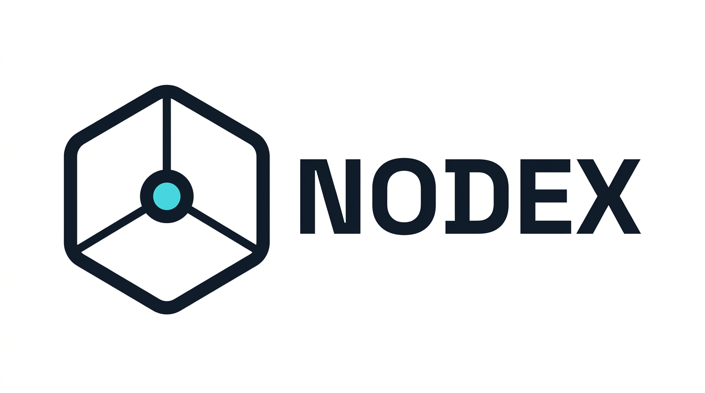

<p align="center">
  <a href="README.md">Español</a> | <b>English</b>
</p>

<h1 align="center">
  <picture>
    <source media="(prefers-color-scheme: dark)" srcset="assets/branding/nodex-logo-dark.png">
    
  </picture>
</h1>

<p align="center">
  Fictional online store of premium tech accessories for workspaces, with its own brand identity and a minimalist design.
</p>

<p align="center">
  <a href="LICENSE"></a>
</p>

## About

NODEX is a fictional premium technology and workspace accessories brand: charging stations, lighting, keyboards and connectivity accessories. This repository brings together its brand identity, the Figma prototype and the mockup of its online store: a homepage and the NODEX Dock product page.

Products, prices and data are fictional, and no real functionality is implemented (cart, checkout, search, filters).

## Brand identity

### Name and logo rationale

**NODEX** combines **"Nod-"** (*node*: the point where power, data and connections converge) and **"-ex"** (*extension* and *desk*: expanding and organizing the workspace). It stands for centralizing peripherals, charging, audio and accessories in one clean, functional hub (*"One desk, one cable"*).

The logo reflects this with an isometric hexagon whose three edges converge on a central cyan node.

### Color palette

| Color | HEX | Usage |
|---|---|---|
| Midnight | `#101B28` | Dark backgrounds and main text |
| Porcelain | `#F4F6F8` | Light section backgrounds |
| Electric Cyan | `#43D7DF` | Accent color: buttons and highlighted elements |
| Titanium | `#9AA8B5` | Secondary text and borders |
| White | `#FFFFFF` | Surfaces and cards |

### Typography

| Font | Usage |
|---|---|
| Space Grotesk | Headings |
| Inter | Body text and interface |

## Tech stack

Figma (Sketchy Wireframes) · Semantic HTML5 · SASS · BEM · Mobile First · Git and GitHub

## Structure

```
nodex/
├── .github/            # Check workflow, PR template and CODEOWNERS
├── assets/branding/    # Logo and icon
├── CONTRIBUTING.md     # Guía de contribución
├── CONTRIBUTING.en.md  # Contribution guide
├── LICENSE
├── README.md
└── README.en.md
```

## Getting started

To be completed once the mockup exists.

## Contributing

Working rules (branches, commits and Pull Requests) are in the [contribution guide](CONTRIBUTING.en.md).

## Notice

NODEX is a working name. Its availability has not been checked in trademark registries (OEPM, EUIPO). The name, logo and brand texts were created with the help of AI.

## Authors

Pablo Ubieto Foncillas ([@PabloUbieto](https://github.com/PabloUbieto)) and Álvaro López Martínez ([@alvaaroms](https://github.com/alvaaroms)).

## License

This project is released under the [MIT license](LICENSE).
