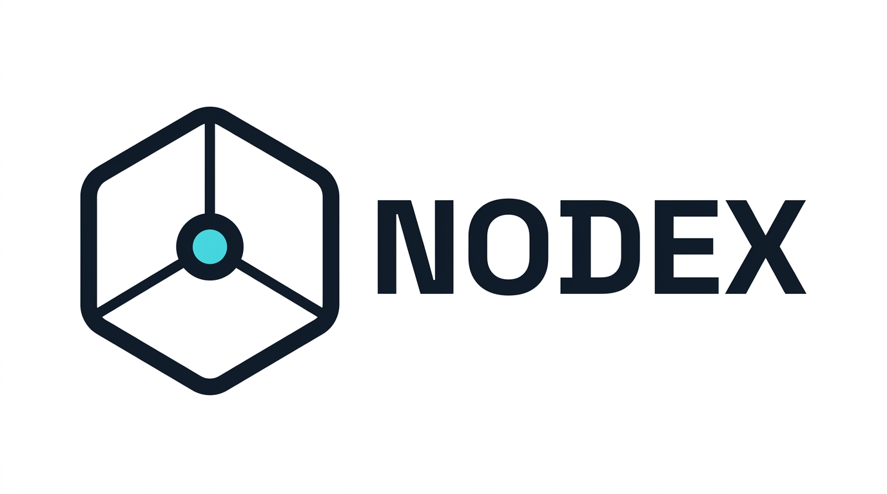

<p align="center">
  <b>Español</b> | <a href="README.en.md">English</a>
</p>

<h1 align="center">
  <picture>
    <source media="(prefers-color-scheme: dark)" srcset="assets/branding/nodex-logo-dark.png">
    
  </picture>
</h1>

<p align="center">
  Tienda online ficticia de accesorios tecnológicos premium para espacios de trabajo, con identidad de marca propia y diseño minimalista.
</p>

<p align="center">
  <a href="LICENSE"></a>
</p>

## Descripción

NODEX es una marca ficticia de tecnología y accesorios premium para espacios de trabajo: estaciones de carga, iluminación, teclados y accesorios de conectividad. Este repositorio reúne su identidad de marca, el prototipo en Figma y la maqueta de su tienda online: una homepage y la ficha de producto de NODEX Dock.

Los productos, precios y datos son ficticios y no se implementa funcionalidad real (carrito, pago, buscador, filtros).

## Identidad de marca

### Justificación del nombre y el logotipo

**NODEX** combina **«Nod-»** (*nodo*: el punto donde convergen energía, datos y conexiones) y **«-ex»** (*extensión* y *desk*: ampliar y ordenar el espacio de trabajo). Representa la idea de centralizar periféricos, carga, audio y accesorios en un punto limpio y funcional (*«Un escritorio, un solo cable»*).

El logotipo lo refleja con un hexágono isométrico cuyas tres aristas convergen en un nodo central cian.

### Paleta de color

| Color | HEX | Uso |
|---|---|---|
| Midnight | `#101B28` | Fondos oscuros y texto principal |
| Porcelain | `#F4F6F8` | Fondos claros de las secciones |
| Electric Cyan | `#43D7DF` | Color de acento: botones y elementos destacados |
| Titanium | `#9AA8B5` | Texto secundario y bordes |
| White | `#FFFFFF` | Superficies y tarjetas |

### Tipografías

| Fuente | Uso |
|---|---|
| Space Grotesk | Titulares |
| Inter | Texto de párrafo e interfaz |

## Tecnologías

Figma (Sketchy Wireframes) · HTML5 semántico · SASS · BEM · Mobile First · Git y GitHub

## Estructura

```
nodex/
├── .github/            # Workflow de comprobación, plantilla de PR y CODEOWNERS
├── assets/branding/    # Logotipo e icono
├── CONTRIBUTING.md     # Guía de contribución
├── CONTRIBUTING.en.md  # Contribution guide
├── LICENSE
├── README.md
└── README.en.md
```

## Puesta en marcha

Se completará cuando exista la maqueta.

## Contribuir

Las normas de trabajo (ramas, commits y Pull Requests) están en la [guía de contribución](CONTRIBUTING.md).

## Aviso

NODEX es un nombre de trabajo. No se ha verificado su disponibilidad en los registros de marcas (OEPM, EUIPO). El nombre, el logotipo y los textos de la marca se han creado con ayuda de IA.

## Autores

Pablo Ubieto Foncillas ([@PabloUbieto](https://github.com/PabloUbieto)) y Álvaro López Martínez ([@alvaaroms](https://github.com/alvaaroms)).

## Licencia

Este proyecto se publica bajo la [licencia MIT](LICENSE).
